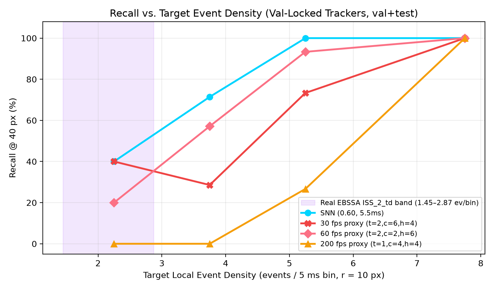

# Neuromorphic SSA Benchmark: Spiking Conv-LIF & Hybrid RSO Tracking

An end-to-end event-based Space Situational Awareness (SSA) benchmark and tracking framework comparing a classical **Constant-Velocity Kalman Filter** against a lightweight **Spiking Convolutional LIF Tracker (`snnTorch`)** and an **Uncertainty-Gated Hybrid SNN+Kalman** architecture across calibrated synthetic regimes, **zero-shot real-sky EBSSA telescope data**, and **multi-object (`ISS_2_td`) tracking**.

---

## Architecture Overview

1. **Event Representation:** Raw asynchronous ON/OFF events are binned into 5 ms frames on an `86 × 65` spatial grid (4× downsampling of `346 × 260`) with `log1p` count compression.
2. **Spiking Conv-LIF Front-End (`models/snn_tracker.py`):** Three `Conv2d → BatchNorm2d → snn.Leaky` (LIF) layers with learnable membrane decay ($\beta$) and `fast_sigmoid` surrogate gradients. Uncorrelated shot noise decays out while coherent Resident Space Object (RSO) trajectories integrate membrane potential and spike at **6%–16% mean sparsity**.
3. **Differentiable 2D Spatial Soft-Argmax + Spread Readout:** A `1 × 1` head converts final-layer spikes and membrane potential into a spatial probability map $p_i$, outputting continuous `(x, y)` coordinates and spatial spread:
   $$\sigma_{xy} = \sqrt{\sum_i p_i \left((x_i - \hat{x})^2 + (y_i - \hat{y})^2\right)}$$
4. **Uncertainty-Gated Hybrid SNN+KF (`eval/eval_hybrid_tracker.py`):** Feeds SNN detections into a gated 2D Constant-Velocity Kalman Filter only when $\sigma_{xy} \le 35\text{ px}$, rejecting soft-argmax jumps during silent windows while avoiding fragile clustering initialization.
5. **Multi-Peak + Kalman MOT (`eval/eval_mot_iss.py`):** Extracts NMS local maxima from the spatial probability map and associates detections across active tracks using Hungarian/gated distance assignment with a 2D Constant-Velocity Kalman Filter.

---

## Benchmark Results

### 1. Synthetic `benchmark_v2` (Unseen Test Split — 9 Passes)
Evaluated across three calibrated regimes (`easy_staring`, `medium_clutter`, `hard_ebssa`) with 30 train / 9 val / 9 test passes:

| Regime | Kalman Baseline | SNN v2 (`β=0.85`) | Hybrid v2 (SNN+KF) | SNN v3 (`β=0.95` + HM) | Hybrid v3 (SNN+KF) |
| :--- | :---: | :---: | :---: | :---: | :---: |
| **`easy_staring`** | 1.89 px | **1.25 px** *(6.8% spk)* | 2.79 px | 3.02 px *(12.2% spk)* | 4.47 px |
| **`medium_clutter`** | 2.40 px | 2.08 px *(12.9% spk)* | **2.02 px** | 4.73 px *(14.0% spk)* | 4.95 px |
| **`hard_ebssa`** | **5.89 px** | 42.22 px *(16.5% spk)* | 32.21 px | 21.32 px *(14.4% spk)* | 21.25 px |

### 2. Zero-Shot Real-Sky EBSSA Transfer (3 Single-Target DAVIS Passes)
Models trained **exclusively on synthetic data** evaluated zero-shot on real telescope recordings from `labelled_ebssa.h5` (2.0 s windows):

| Real-Sky Recording | Kalman Baseline | SNN v2 (Zero-Shot) | Hybrid v2 (SNN+KF) | SNN v3 (Zero-Shot) |
| :--- | :---: | :---: | :---: | :---: |
| **`20170214-20-58_22285_SL-16RB`** | 10.48 px *(9.91 med)* | 37.39 px *(8.88 med)* | **6.00 px** *(4.71 med)* | 81.31 px |
| **`cosmos_1848_davis_td`** | 216.92 px *(1.2% upd)* | 35.20 px *(32.82 med)* | 35.20 px | **30.22 px** |
| **`SL14RB_leap_1933_davis_td`** | 170.36 px *(1.4% upd)* | **106.26 px** *(105.06 med)* | **106.26 px** | 106.78 px |

### 3. Phase 4: Multi-Object Tracking (`sigmoid` + Focal Loss)

Evaluated on the low-SNR calibrated `benchmark_mot` split (log-uniform target density `0.75–8.0` events/bin matching the real `ISS_2_td` regime; 6 val / 6 test passes). All frame proxies are validation-tuned on the same `val` split and locked for `test`.

| Tracker (Val-Locked Config) | Val R@40 | Val F1@40 | Test R@40 | Test P@40 | Test F1@40 | Test RMSE@40 |
| :--- | :---: | :---: | :---: | :---: | :---: | :---: |
| **SNN (`0.50`, `mm=20, mh=10`)** | **60.0%** | **68.6** | 55.0% | **52.4%** | **53.7** | 6.55 px |
| **30 fps proxy (`t=2,c=4,h=6`)** | 40.0% | 34.8 | 40.0% | **38.1%** | **39.0** | **1.04 px** |
| **60 fps proxy (`t=1,c=6,h=6`)** | 50.0% | 32.3 | **60.0%** | 27.9% | 38.1 | 5.77 px |
| **200 fps proxy (`t=2,c=2,h=2`)** | 15.0% | 24.0 | 20.0% | 36.4% | 25.8 | 2.80 px |

#### Recall vs. Target Event Density (`val+test`, `N=40` targets, `R@40px`)

At matching `5 ms` (`200 fps`) temporal resolution, stateless frame integration collapses in faint-target regimes, whereas the SNN's LIF membrane integration maintains a clear recall advantage inside the `1.5–4.5` events/bin band:

| Target Density (ev / 5 ms bin) | SNN (`0.50`) | 60 fps proxy | 30 fps proxy | 200 fps proxy |
| :--- | :---: | :---: | :---: | :---: |
| **`[1.5–3.0]` (`ISS_2_td` band, `n=17`)** | **52.9%** | 35.3% | 5.9% | 5.9% |
| **`[3.0–4.5]` (`n=5`)** | **60.0%** | 40.0% | 40.0% | 0.0% |
| **`[4.5–6.0]` (`n=7`)** | **100.0%** | 100.0% | 100.0% | 14.3% |
| **`[6.0–9.5]` (`n=6`)** | **100.0%** | 100.0% | 100.0% | 83.3% |

* **Zero-Shot Real-Sky `ISS_2_td` Transfer (`304×240` ATIS):** Combining low-SNR calibration (`0.75–8.0` ev/bin), `100 ms` track persistence (`max_missed=20, min_hits=10`), and a `30 Hz` static hot-pixel filter cuts clutter from `11` to `4` tracks and achieves **`2/2` zero-shot lock** on the `91.50 s` crossing window (`Obj 2`: `4.11 px` RMSE, `14.4%` overlap; `Obj 10`: `12.99 px` RMSE, `3.3%` overlap; mean `8.55 px`). Overlap remains partial and fainter windows (`78.00 s`, `0/2` with `0` FP) still reflect the `304×240` vs. `240×180` sensor domain gap.

## Real-Sky Trajectory Comparison (`SL-16RB`)

---

## Compute & Neuromorphic Efficiency (`SpikingConvLIFTracker v2`)

* **Model Footprint:** `20,356` parameters (`79.5 KB` FP32)
* **Real-Time Latency (5 ms bin budget):** `0.474 ms/step` on RTX 5070 Laptop GPU (`10.6×` real-time) | `2.212 ms/step` on CPU (`2.3×` real-time)

| Dataset / Regime | Input Non-Zero | Mean Spike Rate | Dense MACs / Step | Sparse SynOps / Step | Op Reduction | Est. 45 nm Energy / Step |
| :--- | :---: | :---: | :---: | :---: | :---: | :---: |
| **`easy_staring`** | 0.54% | 6.79% | 112.16M | 4.92M | **22.8×** | **4.61 µJ** *(112.0× less)* |
| **`medium_clutter`** | 1.78% | 12.92% | 112.16M | 10.61M | **10.6×** | **10.14 µJ** *(50.9× less)* |
| **`hard_ebssa`** | 2.70% | 16.47% | 112.16M | 13.72M | **8.2×** | **13.24 µJ** *(39.0× less)* |
| **`EBSSA SL-16RB` (Real-Sky)** | 0.57% | 6.16% | 112.16M | 4.43M | **25.3×** | **4.17 µJ** *(123.7× less)* |

*Energy estimated using standard 45 nm CMOS figures (Horowitz, 2014: 4.6 pJ/FP32 MAC, 0.9 pJ/FP32 AC). Run `python eval/profile_snn.py` to reproduce.*

---

## Quickstart

~~~bash
# 1. Generate the 48-pass calibrated synthetic benchmark
python sim/gen_dataset.py --out_root data/benchmark_v2 --num_train 30 --num_val 9 --num_test 9

# 2. Train the Spiking Conv-LIF tracker (v2 champion settings)
python models/train_snn.py --manifest data/benchmark_v2/manifest.csv --beta 0.85 --hm_weight 0.0 --out_ckpt checkpoints/snn_tracker_v2_best.pt

# 3. Run paired synthetic + zero-shot real-sky EBSSA Hybrid evaluation
python eval/eval_hybrid_tracker.py

# 4. Profile latency and SynOps, or run the ISS_2_td multi-object evaluation
python eval/profile_snn.py
# 5. Generate, train, and evaluate the Phase 4 multi-object SNN (sigmoid + Focal Loss)
python sim/gen_mot_dataset.py
python models/train_snn_mot.py --epochs 25
python eval/eval_mot_synth.py
python eval/eval_mot_iss.py --recording ISS_2_td --duration_s 2.0 --start_offset_s 92.87 --ckpt checkpoints/snn_mot_best.pt --mode sigmoid --prob_thresh 0.25
~~~

---

## Repository Structure

~~~text
neuromorphic-ssa-benchmark/
├── sim/
│   └── gen_dataset.py              # Multi-regime synthetic event-stream generator
├── baselines/
│   ├── kalman_tracker.py           # 2D Constant-Velocity Kalman Filter + clustering
│   └── eval_kalman_benchmark.py    # Multi-regime Kalman benchmark runner
├── models/
│   ├── snn_tracker.py              # SpikingConvLIFTracker (snnTorch + spatial soft-argmax)
│   └── train_snn.py                # Training loop with H/V flip augmentation & heatmap loss
├── eval/
│   ├── eval_ebssa_zeroshot.py      # Zero-shot real-sky EBSSA evaluator
│   ├── eval_hybrid_tracker.py      # Uncertainty-gated Hybrid SNN+KF benchmark
│   ├── eval_mot_iss.py             # Multi-peak + Kalman MOT evaluator on ISS_2_td
│   └── profile_snn.py              # Step latency, sparsity, and SynOps profiler
└── results/
    ├── hybrid_ebssa_*.png          # Real-sky trajectory comparison plots
    └── mot_ISS_2_td.png            # Multi-object tracking diagnostic plot
~~~

## Laser Orbital Debris Removal (LODR) Error Budget
**System Role (Coarse Acquisition Only):** At `31.0 µrad/px` (`6.4"/px`), even the spatial RMSE alone (`2.27–3.99 px` = `70–124 µrad`) is an order of magnitude wider than a seeing-limited `1 m` laser beam (`4.21 µrad` 1/e² radius at `1.0"` FWHM seeing). Accordingly, the SNN operates strictly as a **coarse acquisition stage** handing off to a second-stage fine-pointing / adaptive-optics (AO) loop. Panel B of the design curve models that second fine-track loop, not the coarse SNN tracker.

### 1. Coarse Acquisition Pointing Offset (Measured RMSE + Latency Lower Bound)
Frame baselines (`baselines/eval_frame_mot.py`) bin the identical `benchmark_mot` test events into `1/30 s`, `1/60 s`, and `1/200 s` frames and run connected-component centroiding + Kalman association (`30 fps`: `5.42 px` RMSE, `17.1%` P; `60 fps`: `0.68 px` RMSE, `31.6%` R; `200 fps`: `5.53 px` RMSE, `8.5%` P, `30.3` FP/pass, `156` IDSW). Latencies are lower bounds (bin/frame period + compute, excluding camera/host I/O):

| Regime | Rate (mrad/s) | SNN-val (5.5 ms) | SNN-test (5.5 ms) | 200 fps (5.0 ms) | 60 fps* (16.7 ms) | 30 fps (33.3 ms) |
| :--- | :---: | :---: | :---: | :---: | :---: | :---: |
| **ISS (533 km slant)** | 13.86 | 103.6 µrad | 145.2 µrad | 184.8 µrad | 231.9 µrad | 490.1 µrad |
| **LEO 450 km** | 16.99 | 117.0 µrad | 155.0 µrad | 191.3 µrad | 284.5 µrad | 590.1 µrad |
| **LEO 800 km** | 9.32 | 87.1 µrad | 133.9 µrad | 177.7 µrad | 157.1 µrad | 352.9 µrad |
| **LEO 1000 km** | 7.35 | 81.2 µrad | 130.1 µrad | 175.3 µrad | 124.6 µrad | 297.0 µrad |

*\*60 fps achieves only 31.6% recall on the test split (dropping fainter tracks); 200 fps suffers 30.3 FP/pass and 156 IDSW.*

### 2. Unified 1/e² Beam Radius, Pulse Energy & Δv at 800 km LEO
Using a unified 1/e² Gaussian beam radius (`w_diff = 0.82 λ/D`, `w_see = FWHM / sqrt(2 ln 2)`), `λ = 1.06 µm`, `Φ_opt = 53 kJ/m²` (5 ns Al worst case), `C_m = 75 µN·s/J`, `η_c = 0.30`, `µ = 10 kg/m²`, and `1000` pulses/pass **[Phipps et al., 2012, arXiv:1110.3835]**, alongside `D = 1 m` seeing-limited aperture, `±250 µrad` FSM window, `Φ_0 = 106 kJ/m²` (2× margin), and `Φ_th = 15 kJ/m²` **[Assumed]**:

* **Per-pulse / Per-pass Δv [Phipps 2012]:** `119.2 mm/s/pulse` (`119.2 m/s` per 1000-pulse pass) at `Φ_opt = 53 kJ/m²`; `238.5 mm/s/pulse` (`238.5 m/s/pass`) on-axis at `Φ_0 = 106 kJ/m²`.

| Seeing (FWHM) | w_θ (1/e²) | Spot r @ 800 km | E_p @ 53 kJ/m² | E_p @ 106 kJ/m² |
| :--- | :---: | :---: | :---: | :---: |
| **0.5" seeing** | 2.23 µrad | 1.79 m | 0.27 MJ | 0.53 MJ |
| **1.0" seeing** | 4.21 µrad | 3.37 m | 0.94 MJ | 1.89 MJ |
| **2.0" seeing** | 8.28 µrad | 6.62 m | 3.65 MJ | 7.31 MJ |

*Reference [Phipps 2012]: A 13 m AO mirror focuses to a 0.155 m spot radius at 1000 km, requiring only `7.3 kJ/pulse`.*

