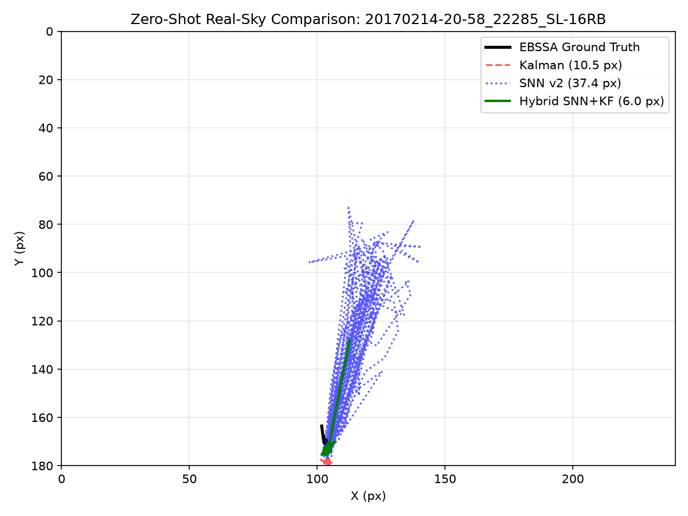

# Neuromorphic SSA Benchmark: Spiking Conv-LIF & Hybrid RSO Tracking

An end-to-end event-based Space Situational Awareness (SSA) benchmark and tracking framework comparing a classical **Constant-Velocity Kalman Filter** against a lightweight **Spiking Convolutional LIF Tracker (`snnTorch`)** and an **Uncertainty-Gated Hybrid SNN+Kalman** architecture across both calibrated synthetic regimes and **zero-shot real-sky EBSSA telescope data**.

---

## Architecture Overview

1. **Event Representation:** Raw asynchronous ON/OFF events are binned into 5 ms frames on an `86 × 65` spatial grid (4× downsampling of `346 × 260`) with `log1p` count compression.
2. **Spiking Conv-LIF Front-End (`models/snn_tracker.py`):** Three `Conv2d → BatchNorm2d → snn.Leaky` (LIF) layers with learnable membrane decay ($\beta$) and `fast_sigmoid` surrogate gradients. Uncorrelated shot noise decays out while coherent Resident Space Object (RSO) trajectories integrate membrane potential and spike at **6%–16% mean sparsity**.
3. **Differentiable 2D Spatial Soft-Argmax + Spread Readout:** A `1 × 1` head converts final-layer spikes and membrane potential into a spatial probability map $p_i$, outputting continuous `(x, y)` coordinates and spatial spread:
   $$\sigma_{xy} = \sqrt{\sum_i p_i \left((x_i - \hat{x})^2 + (y_i - \hat{y})^2\right)}$$
4. **Uncertainty-Gated Hybrid SNN+KF (`eval/eval_hybrid_tracker.py`):** Feeds SNN detections into a gated 2D Constant-Velocity Kalman Filter only when $\sigma_{xy} \le 35\text{ px}$, rejecting soft-argmax jumps during silent windows while avoiding fragile clustering initialization.

---

## Benchmark Results

### 1. Synthetic `benchmark_v2` (Unseen Test Split — 9 Passes)
Evaluated across three calibrated regimes (`easy_staring`, `medium_clutter`, `hard_ebssa`) with 30 train / 9 val / 9 test passes:

| Regime | Kalman Baseline | SNN v2 (`β=0.85`) | Hybrid v2 (SNN+KF) | SNN v3 (`β=0.95` + HM) | Hybrid v3 (SNN+KF) |
| :--- | :---: | :---: | :---: | :---: | :---: |
| **`easy_staring`** | 1.89 px | **1.25 px** *(6.8% spk)* | 2.79 px | 3.02 px *(12.2% spk)* | 4.47 px |
| **`medium_clutter`** | 2.40 px | 2.08 px *(12.9% spk)* | **2.02 px** | 4.73 px *(14.0% spk)* | 4.95 px |
| **`hard_ebssa`** | **5.89 px** | 42.22 px *(16.5% spk)* | 32.21 px | 21.32 px *(14.4% spk)* | 21.25 px |

### 2. Zero-Shot Real-Sky EBSSA Transfer (3 Single-Target DAVIS Passes)
Models trained **exclusively on synthetic data** evaluated zero-shot on real telescope recordings from `labelled_ebssa.h5` (2.0 s windows):

| Real-Sky Recording | Kalman Baseline | SNN v2 (Zero-Shot) | Hybrid v2 (SNN+KF) | SNN v3 (Zero-Shot) |
| :--- | :---: | :---: | :---: | :---: |
| **`20170214-20-58_22285_SL-16RB`** | 10.48 px *(9.91 med)* | 37.39 px *(8.88 med)* | **6.00 px** *(4.71 med)* | 81.31 px |
| **`cosmos_1848_davis_td`** | 216.92 px *(1.2% upd)* | 35.20 px *(32.82 med)* | 35.20 px | **30.22 px** |
| **`SL14RB_leap_1933_davis_td`** | 170.36 px *(1.4% upd)* | **106.26 px** *(105.06 med)* | **106.26 px** | 106.78 px |

### Key Takeaways & Ablation (`v2` vs. `v3`)
* **Zero-Shot Sim-to-Real Win:** On `SL-16RB`, the spread-gated **Hybrid v2** tracker achieves **6.00 px RMSE (4.71 px median)**—beating both the classical Kalman filter (`10.48 px`) and raw SNN (`37.39 px`). On `cosmos_1848`, classical clustering fails to initialize (`1.2%` updates, `216.92 px`), while the SNN tracks zero-shot at `30–35 px`.
* **Temporal Decay ($\beta$) Tradeoff:** Increasing LIF decay from `0.85` (`v2`) to `0.95` (`v3`) with Gaussian heatmap supervision **halved** synthetic `hard_ebssa` error (`42.22 → 21.32 px`) and improved sparse `cosmos_1848` (`35.20 → 30.22 px`), but introduced membrane lag on fast targets and reduced zero-shot transfer on `SL-16RB`.

---

## Real-Sky Trajectory Comparison (`SL-16RB`)

---

## Quickstart

~~~bash
# 1. Generate the 48-pass calibrated synthetic benchmark
python sim/gen_dataset.py --out_root data/benchmark_v2 --num_train 30 --num_val 9 --num_test 9

# 2. Train the Spiking Conv-LIF tracker (v2 champion settings)
python models/train_snn.py --manifest data/benchmark_v2/manifest.csv --beta 0.85 --hm_weight 0.0 --out_ckpt checkpoints/snn_tracker_v2_best.pt

# 3. Run paired synthetic + zero-shot real-sky EBSSA Hybrid evaluation
python eval/eval_hybrid_tracker.py
~~~

---

## Repository Structure

~~~text
neuromorphic-ssa-benchmark/
├── sim/
│   └── gen_dataset.py              # Multi-regime synthetic event-stream generator
├── baselines/
│   ├── kalman_tracker.py           # 2D Constant-Velocity Kalman Filter + clustering
│   └── eval_kalman_benchmark.py    # Multi-regime Kalman benchmark runner
├── models/
│   ├── snn_tracker.py              # SpikingConvLIFTracker (snnTorch + spatial soft-argmax)
│   └── train_snn.py                # Training loop with H/V flip augmentation & heatmap loss
├── eval/
│   ├── eval_ebssa_zeroshot.py      # Zero-shot real-sky EBSSA evaluator
│   └── eval_hybrid_tracker.py      # Uncertainty-gated Hybrid SNN+KF benchmark
└── results/
    └── hybrid_ebssa_*.png          # Real-sky trajectory comparison plots
~~~

---

## Compute & Neuromorphic Efficiency (`SpikingConvLIFTracker v2`)

* **Model Footprint:** `20,356` parameters (`79.5 KB` FP32)
* **Real-Time Latency (5 ms bin budget):** `0.474 ms/step` on RTX 5070 Laptop GPU (`10.6×` real-time) | `2.212 ms/step` on CPU (`2.3×` real-time)

| Dataset / Regime | Input Non-Zero | Mean Spike Rate | Dense MACs / Step | Sparse SynOps / Step | Op Reduction | Est. 45 nm Energy / Step |
| :--- | :---: | :---: | :---: | :---: | :---: | :---: |
| **`easy_staring`** | 0.54% | 6.79% | 112.16M | 4.92M | **22.8×** | **4.61 µJ** *(112.0× less)* |
| **`medium_clutter`** | 1.78% | 12.92% | 112.16M | 10.61M | **10.6×** | **10.14 µJ** *(50.9× less)* |
| **`hard_ebssa`** | 2.70% | 16.47% | 112.16M | 13.72M | **8.2×** | **13.24 µJ** *(39.0× less)* |
| **`EBSSA SL-16RB` (Real-Sky)** | 0.57% | 6.16% | 112.16M | 4.43M | **25.3×** | **4.17 µJ** *(123.7× less)* |

*Energy estimated using standard 45 nm CMOS figures (Horowitz, 2014: 4.6 pJ/FP32 MAC, 0.9 pJ/FP32 AC). Run `python eval/profile_snn.py` to reproduce.*
