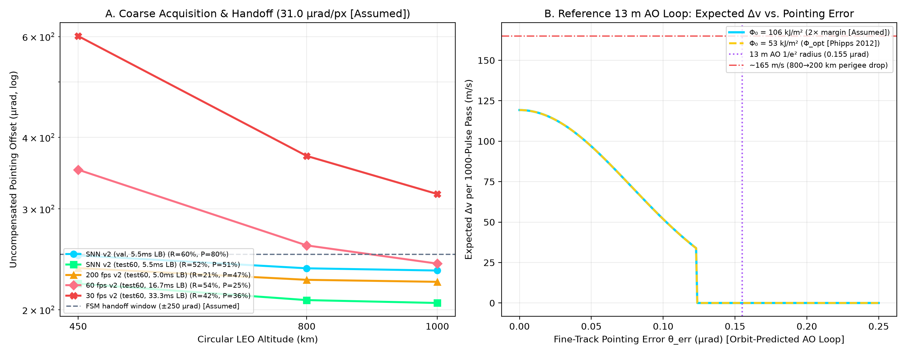

# Neuromorphic SSA Benchmark: Spiking Conv-LIF & Hybrid RSO Tracking

An end-to-end event-based Space Situational Awareness (SSA) benchmark and tracking framework comparing a classical **Constant-Velocity Kalman Filter** against a lightweight **Spiking Convolutional LIF Tracker (`snnTorch`)** and an **Uncertainty-Gated Hybrid SNN+Kalman** architecture across calibrated synthetic regimes, **zero-shot real-sky EBSSA telescope data**, and **multi-object (`ISS_2_td`) tracking**.

---

## Architecture Overview

1. **Event Representation:** Raw asynchronous ON/OFF events are binned into 5 ms frames on an `86 × 65` spatial grid (4× downsampling of `346 × 260`) with `log1p` count compression.
2. **Spiking Conv-LIF Front-End (`models/snn_tracker.py`):** Three `Conv2d → BatchNorm2d → snn.Leaky` (LIF) layers with learnable membrane decay ($\beta$) and `fast_sigmoid` surrogate gradients. Uncorrelated shot noise decays out while coherent Resident Space Object (RSO) trajectories integrate membrane potential and spike at **6%–16% mean sparsity**.
3. **Differentiable 2D Spatial Soft-Argmax + Spread Readout:** A `1 × 1` head converts final-layer spikes and membrane potential into a spatial probability map $p_i$, outputting continuous `(x, y)` coordinates and spatial spread:
   $$\sigma_{xy} = \sqrt{\sum_i p_i \left((x_i - \hat{x})^2 + (y_i - \hat{y})^2\right)}$$
4. **Uncertainty-Gated Hybrid SNN+KF (`eval/eval_hybrid_tracker.py`):** Feeds SNN detections into a gated 2D Constant-Velocity Kalman Filter only when $\sigma_{xy} \le 35\text{ px}$, rejecting soft-argmax jumps during silent windows while avoiding fragile clustering initialization.
5. **Multi-Peak + Kalman MOT (`eval/eval_mot_iss.py`):** Extracts NMS local maxima from the spatial probability map and associates detections across active tracks using Hungarian/gated distance assignment with a 2D Constant-Velocity Kalman Filter.

---

## Benchmark Results

### 1. Synthetic `benchmark_v2` (Unseen Test Split — 9 Passes)
Evaluated across three calibrated regimes (`easy_staring`, `medium_clutter`, `hard_ebssa`) with 30 train / 9 val / 9 test passes:

| Regime | Kalman Baseline | SNN v2 (`β=0.85`) | Hybrid v2 (SNN+KF) | SNN v3 (`β=0.95` + HM) | Hybrid v3 (SNN+KF) |
| :--- | :---: | :---: | :---: | :---: | :---: |
| **`easy_staring`** | 1.89 px | **1.25 px** *(6.8% spk)* | 2.79 px | 3.02 px *(12.2% spk)* | 4.47 px |
| **`medium_clutter`** | 2.40 px | 2.08 px *(12.9% spk)* | **2.02 px** | 4.73 px *(14.0% spk)* | 4.95 px |
| **`hard_ebssa`** | **5.89 px** | 42.22 px *(16.5% spk)* | 32.21 px | 21.32 px *(14.4% spk)* | 21.25 px |

### 2. Zero-Shot Real-Sky EBSSA Transfer (3 Single-Target DAVIS Passes)
Models trained **exclusively on synthetic data** evaluated zero-shot on real telescope recordings from `labelled_ebssa.h5` (2.0 s windows):

| Real-Sky Recording | Kalman Baseline | SNN v2 (Zero-Shot) | Hybrid v2 (SNN+KF) | SNN v3 (Zero-Shot) |
| :--- | :---: | :---: | :---: | :---: |
| **`20170214-20-58_22285_SL-16RB`** | 10.48 px *(9.91 med)* | 37.39 px *(8.88 med)* | **6.00 px** *(4.71 med)* | 81.31 px |
| **`cosmos_1848_davis_td`** | 216.92 px *(1.2% upd)* | 35.20 px *(32.82 med)* | 35.20 px | **30.22 px** |
| **`SL14RB_leap_1933_davis_td`** | 170.36 px *(1.4% upd)* | **106.26 px** *(105.06 med)* | **106.26 px** | 106.78 px |

### 3. Phase 4: Multi-Object Tracking (`sigmoid` + Focal Loss)

**Benchmark Versioning:** `benchmark_mot_v1` (archived high-SNR, `3–8` ev/bin) is superseded by **`benchmark_mot_v2`** (low-SNR calibrated, log-uniform `0.75–8.0` ev/bin matching `ISS_2_td`). All trackers are validation-tuned on the 6-pass `v2` `val` split and evaluated locked on **`benchmark_mot_v2_test60`** (60 fresh test passes, `189` targets, 1,000-resample bootstrap 95% CIs; `analysis/eval_v2_bootstrap.py`).

| Tracker (Val-Locked Config) | Test R@40 [95% CI] | Test P@40 [95% CI] | Test F1@40 [95% CI] | FP/pass | IDSW | Test RMSE |
| :--- | :---: | :---: | :---: | :---: | :---: | :---: |
| **SNN v2 (`0.50`, `mm=20, mh=10`)** | 52.4% [44.3, 59.3] | **51.0%** [45.9, 56.9] | **51.7** [46.6, 56.5] | 1.58 | 104 | **6.50 px** |
| **30 fps proxy (`t=2,c=4,h=6`)** | 42.3% [35.3, 49.2] | 36.2% [30.8, 42.1] | 39.0 [33.3, 44.5] | 2.35 | 72 | 6.57 px |
| **60 fps proxy (`t=1,c=6,h=6`)** | **54.0%** [47.1, 60.6] | 24.8% [21.1, 29.0] | 33.9 [29.5, 38.6] | 5.17 | 165 | 6.68 px |
| **200 fps proxy (`t=2,c=2,h=2`)** | 20.6% [14.8, 27.4] | 47.0% [38.1, 58.1] | 28.7 [22.0, 34.8] | **0.73** | **43** | 7.12 px |

#### Recall vs. Target Event Density (`benchmark_mot_v2_test60`, `N=189` targets, 95% Bootstrap CI)

| Density Bin (ev / 5 ms) | `n` | SNN v2 (`0.50`) | 30 fps proxy | 60 fps proxy | 200 fps proxy |
| :--- | :---: | :---: | :---: | :---: | :---: |
| **`[0.75, 1.50)`** | 33 | 12.1% [3.0, 24.2] | 9.1% [0.0, 18.2] | 12.1% [3.0, 24.2] | 9.1% [0.0, 18.2] |
| **`[1.50, 3.00)` (`ISS_2_td` band)** | 63 | **42.9%** [31.7, 55.6] | 14.3% [6.3, 23.8] | 25.4% [15.9, 36.5] | 7.9% [1.6, 15.9] |
| **`[3.00, 4.50)`** | 44 | 61.4% [47.7, 75.0] | 45.5% [31.8, 61.4] | **75.0%** [61.4, 86.4] | 6.8% [0.0, 13.6] |
| **`[4.50, 6.00)`** | 20 | 80.0% [60.0, 95.0] | 95.0% [85.0, 100.0] | **100.0%** [100.0, 100.0] | 20.0% [5.0, 40.0] |
| **`[6.00, 9.50)`** | 29 | 86.2% [72.4, 96.6] | **100.0%** [100.0, 100.0] | **100.0%** [100.0, 100.0] | 82.8% [65.5, 96.6] |

#### Real-Sky ATIS Evaluation (`304×240`, Calibrated vs. Frozen Holdout)
* **Calibrated on `ISS_2_td` (`91.50 s` crossing, `2.5 s`, `112,945` events):** Because the synthetic low-SNR range (`0.75–8.0` ev/bin) and `30 Hz` hot-pixel filter were chosen while inspecting `ISS_2_td`, this result is reported as **calibrated on `ISS_2_td`** (not zero-shot). Clutter drops from `11` to `4` tracks and both active targets are matched (`2/2`), with **partial temporal coverage**: `Obj 2` (`4.11 px` RMSE, `14.4%` overlap) and `Obj 10` (`12.99 px` RMSE, `3.3%` overlap; mean `8.55 px`).
* **Fainter `ISS_2_td` window (`78.00 s`, `2.0 s`, `56,190` events):** `0/2` matched (`0` clutter tracks).
* **Untouched Frozen Holdout (`archenar_leos_1149_atis_td`, `0.00–10.00 s`, `634,178` events):** With all settings frozen, `0/1` matched (`5` tracks; closest `T01` at `44.14 px` RMSE, `2.1%` overlap) under ~6.8× denser ATIS background clutter than `ISS_2_td`.

#### Tuning Provenance Log
| Parameter / Component | Tuned / Calibrated On | Locked For |
| :--- | :--- | :--- |
| Frame proxy `(pix_thr, min_cluster, min_hits)` | `benchmark_mot_v2` `val` (6 passes) | `benchmark_mot_v2_test60` (60 passes) |
| SNN `prob_thresh=0.50`, `max_missed=20`, `min_hits=10` | `benchmark_mot_v2` `val` (6 passes) | `benchmark_mot_v2_test60` + `archenar_leos_1149_atis_td` |
| Synthetic density (`0.75–8.0` ev/bin) & `hot_pixel_hz=30.0` | `ISS_2_td` diagnostic inspection | `benchmark_mot_v2_test60` + `archenar_leos_1149_atis_td` |

## Real-Sky Trajectory Comparison (`SL-16RB`)

---

## Compute & Neuromorphic Efficiency (`SpikingConvLIFTracker v2`)

* **Model Footprint:** `20,356` parameters (`79.5 KB` FP32)
* **Real-Time Latency (5 ms bin budget):** `0.474 ms/step` on RTX 5070 Laptop GPU (`10.6×` real-time) | `2.212 ms/step` on CPU (`2.3×` real-time)

| Dataset / Regime | Input Non-Zero | Mean Spike Rate | Dense MACs / Step | Sparse SynOps / Step | Op Reduction | Est. 45 nm Energy / Step |
| :--- | :---: | :---: | :---: | :---: | :---: | :---: |
| **`easy_staring`** | 0.54% | 6.79% | 112.16M | 4.92M | **22.8×** | **4.61 µJ** *(112.0× less)* |
| **`medium_clutter`** | 1.78% | 12.92% | 112.16M | 10.61M | **10.6×** | **10.14 µJ** *(50.9× less)* |
| **`hard_ebssa`** | 2.70% | 16.47% | 112.16M | 13.72M | **8.2×** | **13.24 µJ** *(39.0× less)* |
| **`EBSSA SL-16RB` (Real-Sky)** | 0.57% | 6.16% | 112.16M | 4.43M | **25.3×** | **4.17 µJ** *(123.7× less)* |

*Energy estimated using standard 45 nm CMOS figures (Horowitz, 2014: 4.6 pJ/FP32 MAC, 0.9 pJ/FP32 AC). Run `python eval/profile_snn.py` to reproduce.*

---

## Quickstart

~~~bash
# 1. Generate the 48-pass calibrated synthetic benchmark
python sim/gen_dataset.py --out_root data/benchmark_v2 --num_train 30 --num_val 9 --num_test 9

# 2. Train the Spiking Conv-LIF tracker (v2 champion settings)
python models/train_snn.py --manifest data/benchmark_v2/manifest.csv --beta 0.85 --hm_weight 0.0 --out_ckpt checkpoints/snn_tracker_v2_best.pt

# 3. Run paired synthetic + zero-shot real-sky EBSSA Hybrid evaluation
python eval/eval_hybrid_tracker.py

# 4. Profile latency and SynOps, or run the ISS_2_td multi-object evaluation
python eval/profile_snn.py
# 5. Generate, train, and evaluate the Phase 4 multi-object SNN (sigmoid + Focal Loss)
python sim/gen_mot_dataset.py
python models/train_snn_mot.py --epochs 25
python eval/eval_mot_synth.py
python eval/eval_mot_iss.py --recording ISS_2_td --duration_s 2.0 --start_offset_s 92.87 --ckpt checkpoints/snn_mot_best.pt --mode sigmoid --prob_thresh 0.25
~~~

---

## Repository Structure

~~~text
neuromorphic-ssa-benchmark/
├── sim/
│   └── gen_dataset.py              # Multi-regime synthetic event-stream generator
├── baselines/
│   ├── kalman_tracker.py           # 2D Constant-Velocity Kalman Filter + clustering
│   └── eval_kalman_benchmark.py    # Multi-regime Kalman benchmark runner
├── models/
│   ├── snn_tracker.py              # SpikingConvLIFTracker (snnTorch + spatial soft-argmax)
│   └── train_snn.py                # Training loop with H/V flip augmentation & heatmap loss
├── eval/
│   ├── eval_ebssa_zeroshot.py      # Zero-shot real-sky EBSSA evaluator
│   ├── eval_hybrid_tracker.py      # Uncertainty-gated Hybrid SNN+KF benchmark
│   ├── eval_mot_iss.py             # Multi-peak + Kalman MOT evaluator on ISS_2_td
│   └── profile_snn.py              # Step latency, sparsity, and SynOps profiler
└── results/
    ├── hybrid_ebssa_*.png          # Real-sky trajectory comparison plots
    └── mot_ISS_2_td.png            # Multi-object tracking diagnostic plot
~~~

## Laser Orbital Debris Removal (LODR) Error Budget
**System Role (Coarse Acquisition → Fine AO Handoff):** At `31.0 µrad/px` (`6.4"/px`), the SNN's spatial RMSE alone (`6.50 px` = `201.5 µrad`) is three orders of magnitude wider than a diffraction-limited adaptive-optics (AO) laser beam (`w_θ = 0.155 µrad`). Accordingly, the SNN operates strictly as a **coarse acquisition stage** whose handoff offset must land inside a **`±250 µrad` fine-steering mirror (FSM) capture window** [Assumed] so a second-stage fine-AO loop can close.

### 1. Coarse Acquisition & FSM Handoff Offset (`benchmark_mot_v2_test60`, `31.0 µrad/px`)
All trackers are val-tuned on `benchmark_mot_v2` `val` and locked on `benchmark_mot_v2_test60` (`60` passes, `189` targets). Latencies are lower bounds (bin/frame period + compute, excluding camera/host I/O):

| Regime | Rate (mrad/s) | SNN v2 test60 (5.5 ms) | 200 fps test60 (5.0 ms) | 60 fps test60 (16.7 ms) | 30 fps test60 (33.3 ms) |
| :--- | :---: | :---: | :---: | :---: | :---: |
| **ISS (533 km slant)** | 13.86 | **215.4 µrad** *(in ±250)* | 231.3 µrad *(20.6% R)* | 310.2 µrad *(miss)* | 503.4 µrad *(miss)* |
| **LEO 450 km** | 16.99 | **222.1 µrad** *(in ±250)* | 236.5 µrad *(20.6% R)* | 351.2 µrad *(miss)* | 601.2 µrad *(miss)* |
| **LEO 800 km** | 9.32 | **207.9 µrad** *(in ±250)* | 225.6 µrad *(20.6% R)* | 259.0 µrad *(miss)* | 371.2 µrad *(miss)* |
| **LEO 1000 km** | 7.35 | **205.5 µrad** *(in ±250)* | 223.8 µrad *(20.6% R)* | 240.8 µrad *(in ±250)* | 318.5 µrad *(miss)* |

*`SNN v2 (test60)` stays inside the `±250 µrad` FSM capture window across all four orbital regimes while maintaining `52.4%` recall and `51.0%` precision (`F1 = 51.7`). `60 fps` and `30 fps` exceed `±250 µrad` at `450–800 km`, while `200 fps` drops to `20.6%` recall.*

### 2. Reference AO Fine-Pointing Coupling (`w_θ = 0.155 µrad`, `Φ_0 = 53.0 kJ/m²`)
Following **Phipps et al. (2012, arXiv:1110.3835)** (`13 m` AO mirror → `0.155 m` 1/e² spot radius at `1000 km`, `w_θ = 0.155 µrad`, `E_p = 7.3 kJ`, `Φ_0 = Φ_opt = 53.0 kJ/m²` for `5 ns` pulse on Al, `C_m = 75 µN·s/J`, `η_c = 0.30`, `µ = 10 kg/m²`, `1000` pulses/pass, `Φ_th = 15.0 kJ/m²` [Assumed]):

* **Orbital Δv Sanity Check:** Lowering an `800 km` circular orbit to a `200 km` perigee requires **`164.6 m/s`** (exact Hohmann transfer). On-axis at `Φ_0 = 53.0 kJ/m²`, `1000` pulses deliver **`119.2 m/s` per pass** (~`1.4` passes to deorbit).
* **Fine-Loop Latency Tolerance:** Holding `0.10 µrad` at `800 km` (`9.32 µrad/ms`) permits only **`~10.7 µs`** of uncompensated latency—requiring orbital-dynamics prediction inside the fine-AO loop.

| Fine-AO Pointing Error | Delivered Fluence `Φ` | Expected `Δv` / 1000-Pulse Pass |
| :---: | :---: | :---: |
| **`0.00 µrad`** | `53.0 kJ/m²` | **`119.2 m/s`** |
| **`0.05 µrad`** | `43.0 kJ/m²` | `96.8 m/s` |
| **`0.09 µrad`** | `27.0 kJ/m²` | `60.8 m/s` |
| **`0.12 µrad`** | `16.0 kJ/m²` | `36.0 m/s` |
| **`0.15 µrad`** | `8.1 kJ/m²` *(< Φ_th)* | `0.0 m/s` |

